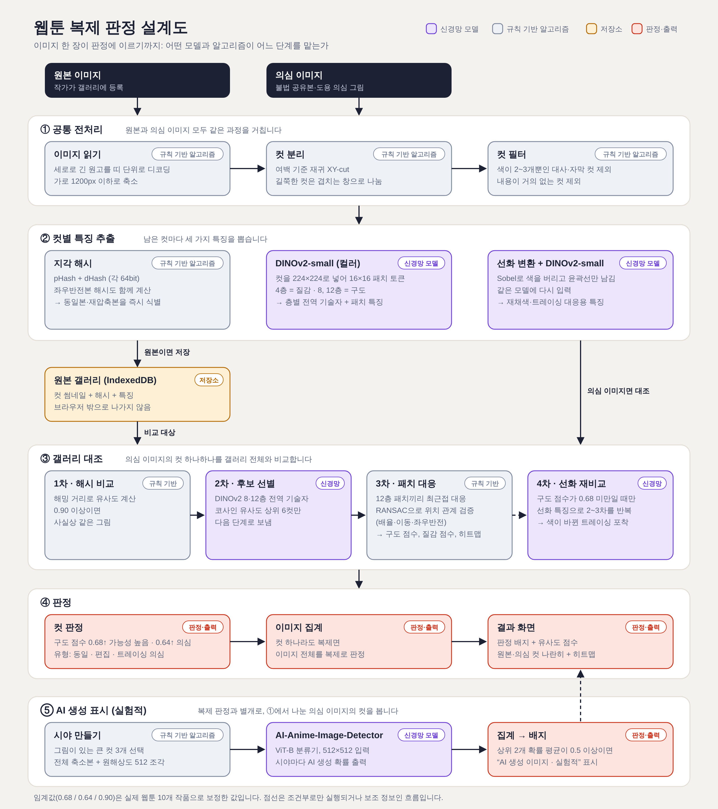

# 웹툰 복제 탐지기

[English](README.md) | **한국어**

원본 웹툰 이미지를 브라우저에 등록해 두고, 의심 이미지를 올리면 컷 단위로 복제·편집·트레이싱 여부를 찾아내는 정적 웹사이트입니다. 모든 분석은 브라우저 안에서 이뤄지며 이미지는 어디에도 전송되지 않습니다.

## 바로 써 보기

**https://saetu0422.github.io/webtoon-copy-detector/**

설치 없이 위 주소에서 바로 시험해 볼 수 있습니다. 사용법은 사이트 상단의 "사용법"에 있습니다.

- 시험용 데모입니다. 주소나 동작이 예고 없이 바뀔 수 있습니다.
- 올린 이미지는 서버로 전송되지 않고, 갤러리는 사용 중인 브라우저에만 저장됩니다.
- 첫 검사 때 모델(복제 탐지 약 24MB, AI 생성 탐지 약 89MB)을 한 번 내려받습니다.

## 실행

```bash
npm install
```

```bash
npm run dev
```

배포용 빌드는 `npm run build` 후 `dist/` 폴더를 정적 호스팅에 올리면 됩니다. 모델 파일(`public/models/`, 약 108MB)이 함께 올라갑니다.

`main`에 푸시하면 `.github/workflows/pages.yml`이 빌드해서 GitHub Pages에 배포합니다 (저장소 Settings → Pages의 Source가 "GitHub Actions"여야 합니다).

- 서버가 `Cross-Origin-Opener-Policy: same-origin`, `Cross-Origin-Embedder-Policy: require-corp` 헤더를 주면 WASM 멀티스레드가 켜져 더 빠릅니다. 헤더가 없어도 단일 스레드로 동작합니다.
- `onnxruntime-web` 버전을 올리면 `public/ort/`의 두 파일도 `node_modules/onnxruntime-web/dist/`에서 다시 복사해야 합니다.

## 판정 과정



설계도 원본은 `docs/architecture.svg`이며 `python tools/make_diagram.py`로 다시 생성합니다.

1. **컷 분리** (`src/core/panels.js`) — 여백 기준 재귀 XY-cut. 색이 2~3개뿐인 말풍선·자막 컷과 내용이 거의 없는 컷은 근거에서 뺍니다.
2. **해시** (`hash.js`) — pHash + dHash, 좌우반전본 포함.
3. **다층 특징 검색** (`embed.js`, `match.js`) — DINOv2-small의 4·8·12층 토큰을 내보내 층별 전역 기술자로 후보를 고릅니다.
4. **패치 대응 + 기하 검증** (`match.js`) — 패치 친화도 최근접 대응 → RANSAC(배율·이동·반전) → 정렬된 패치 유사도 맵. 이 맵이 화면의 히트맵입니다.
5. **선화 재비교** (`pipeline.js`) — 색 도메인에서 확신이 없으면 윤곽선만 남긴 그림끼리 다시 비교합니다.
6. **집계** (`search.js`) — 컷 하나라도 복제면 이미지 전체를 복제로 봅니다.
7. **AI 생성 표시, 실험적** (`aidetect.js`) — 공개 분류기를 큰 컷 3개의 여러 시야에 적용하고 상위 2개 확률을 평균합니다.

참고한 연구: Learning to Falsify (arXiv 2611.04529, 반증 원칙 집계), GILA (arXiv 2611.00017, 다층 표현), CopyNCE (arXiv 2602.17484, 패치 친화도). 이 논문들의 학습 방법을 재현한 것이 아니라, 사전학습 모델 위에 아이디어를 적용한 것입니다.

## 자체 점검 수치

실제 웹툰 10개 작품(각 4000px 청크 3개를 갤러리로, 컷 198개)으로 `node scripts/e2e.mjs <청크 폴더>`를 돌린 결과입니다.

| 경우 | 이미지 단위 "가능성 높음" | 컷 일치율 |
|---|---|---|
| 재압축+축소 / 좌우반전 / 색조 변경 / 대사 제거 | 15/15 | 0.99~1.00 |
| 부분 잘라내기 | 15/15 | 0.79 |
| 워터마크+여백 | 15/15 | 0.95 |
| 재채색 트레이싱(합성 모사) | 15/15 | 0.78 |
| 선화 트레이싱(합성 모사) | 12/15 | 0.55 |
| 같은 작품의 다른 페이지(음성) | 0/28 ("의심" 6/28) | 확정 0.0%, 의심 5.7% |

트레이싱 두 줄은 필터로 만든 모사본이라 손으로 다시 그린 실제 트레이싱의 성능을 뜻하지 않습니다. 임계값(`search.js`의 `TH`)은 이 10개 작품에 맞춘 값이라 화풍이 크게 다른 작품에서는 달라질 수 있습니다.

AI 생성 분류기는 사람이 그린 웹툰 40장 중 0~1장을 AI로 오판했고, NijiJourney 생성 이미지 24장 중 7장만 잡았습니다(`tools/test_aidet.py`).

## 다른 모델과의 비교

같은 컷으로 직접 측정했습니다. 갤러리 컷 181개, 변형 복제 질의 549개(컷 61개 × 변형 9종), 음성 질의 158개(같은 작품들의 다른 페이지 컷)입니다. 기준 모델은 컷을 정사각으로 리사이즈해 전역 임베딩의 코사인 유사도로 갤러리를 검색했습니다.

| 방법 | 원본 찾기 정확도 | 검출률 (오탐 5%) | 검출률 (오탐 1%) | 일반 편집 7종 | 트레이싱 모사 2종 |
|---|---|---|---|---|---|
| **본 시스템 (전체)** | 98.4% | 89.1% | 86.5% | 95.3% | 67.2% |
| SSCD ResNet-50 (복제 탐지 전용 모델) | 96.5% | 75.2% | 68.9% | 95.8% | 3.3% |
| DINOv2-base (CLS) | 94.2% | 64.7% | 57.6% | 78.2% | 17.2% |
| 본 시스템의 2차 단계만 (DINOv2-small 다층 전역 기술자) | 94.2% | 70.1% | 60.5% | 85.0% | 18.0% |
| DINOv2-small (CLS) | 91.8% | 58.5% | 55.2% | 74.0% | 4.1% |
| CLIP ViT-B/32 | 85.1% | 47.2% | 35.9% | 60.2% | 1.6% |
| 본 시스템의 1차 단계만 (pHash + dHash) | 61.7% | 57.6% | 56.5% | 57.6% | 57.4% |

- **원본 찾기 정확도**: 갤러리에서 1순위로 뽑은 컷이 실제 원본인 비율.
- **검출률 (오탐 N%)**: 음성 질의의 N%만 걸리도록 임계값을 잡았을 때, 복제 질의가 올바른 원본과 함께 잡힌 비율. 임계값에 의존하지 않는 비교를 위해 방법마다 임계값을 따로 잡았습니다.

변형별 검출률 (오탐 5% 기준):

| 변형 | 본 시스템 | SSCD | DINOv2-base | CLIP | pHash+dHash |
|---|---|---|---|---|---|
| 재압축+축소 | 100% | 100% | 100% | 100% | 100% |
| 색조 변경 | 100% | 100% | 100% | 77% | 100% |
| 좌우반전 | 100% | 100% | 100% | 92% | 2% |
| 대사 제거 | 100% | 100% | 97% | 87% | 100% |
| 워터마크 | 97% | 100% | 89% | 16% | 100% |
| 가운데 잘라내기 | 98% | 100% | 51% | 34% | 2% |
| 모서리 잘라내기 | 72% | 70% | 11% | 15% | 0% |
| 재채색 트레이싱(모사) | 80% | 7% | 33% | 3% | 95% |
| 선화 트레이싱(모사) | 54% | 0% | 2% | 0% | 20% |

**읽을 때 주의할 점**

- 본 시스템의 설계(말풍선 컷 필터, 특징 중심화, 선화 재비교)는 이 10개 작품을 보면서 정했고, 기준 모델은 공개 가중치를 그대로 썼습니다. 다른 작품에서는 격차가 줄 수 있습니다.
- 격차의 대부분은 트레이싱 모사 2종에서 나옵니다. 이 변형은 필터로 합성한 것이고 본 시스템의 선화 단계가 바로 이 유형을 겨냥해 만들어졌습니다. 일반 편집 7종만 보면 SSCD와 비슷합니다.
- 음성 질의가 158개뿐이라 오탐 1% 지점은 표본 1~2개로 정해집니다. 5% 기준이 더 안정적입니다.
- 본 시스템은 질의 컷마다 모델을 두 번 돌리고 후보 6~12개와 패치 대응을 하므로, 전역 임베딩 한 번으로 끝나는 기준 모델보다 느리고 대규모 갤러리에는 맞지 않습니다.
- SSCD 가중치는 Hugging Face 미러(m3/sscd-copy-detection)에서 받았습니다.

재현: `node scripts/bench.mjs <청크 폴더> <출력 폴더>` 후 `python tools/bench_baselines.py <출력 폴더>`. 원 수치는 `docs/benchmark.json`에 있습니다.

## 라이선스

이 프로젝트의 코드는 [Apache License 2.0](LICENSE)으로 공개합니다. 누구나 무료로 사용·수정·재배포할 수 있고 상업적 이용도 가능합니다. 재배포할 때는 `LICENSE`와 `NOTICE`를 함께 포함하고, 수정한 파일에는 수정 사실을 표시해 주세요.

함께 배포하는 모델과 런타임은 각자의 라이선스를 따릅니다 (`NOTICE`, `THIRD_PARTY_LICENSES.md`).

- `dinov2s_int8.onnx` — facebook/dinov2-small (Apache-2.0)을 `tools/export_dinov2.py`로 변환·int8 양자화.
- `anime_ai_detector_int8.onnx` — legekka/AI-Anime-Image-Detector-ViT (Apache-2.0)의 onnx-community 변환본.
- `public/ort/` — ONNX Runtime Web (MIT).
- `src/core/centers.js` — `scripts/centers.mjs`가 계산한 층별 평균 토큰. 비영리 조건(CC BY-NC)으로 공개된 웹툰 샘플에서 계산한 통계값이므로, 상업적으로 쓸 때는 본인 원고로 다시 계산하길 권합니다.
