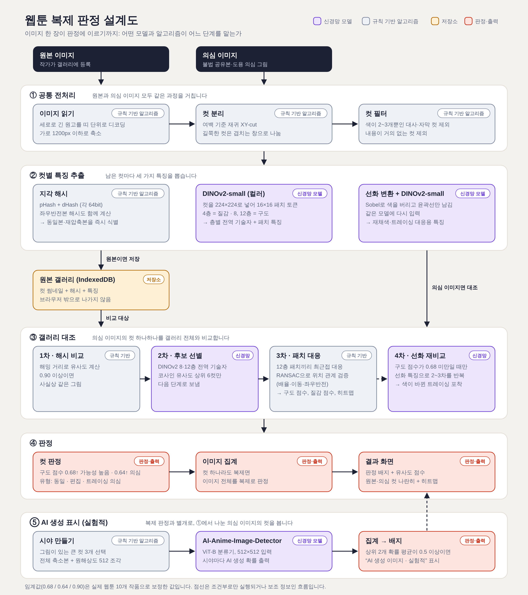

# Webtoon Copy Detector

**English** | [한국어](README.ko.md)

A static website that checks whether a suspect image copies your webtoon. You register your original pages in the browser, upload a suspect image, and it reports copied, edited, or traced panels one by one. All analysis runs in the browser, and no image is sent anywhere.

## Try it now

**https://saetu0422.github.io/webtoon-copy-detector/**

You can test it at the address above without installing anything. The interface is in Korean; a usage guide is at the top of the page.

- This is a trial demo. The address or behavior may change without notice.
- Uploaded images are not sent to a server, and the gallery is stored only in the browser you are using.
- The first check downloads the models once (about 24 MB for copy detection and 89 MB for AI-image detection).

## Run locally

```bash
npm install
```

```bash
npm run dev
```

For deployment, run `npm run build` and upload the `dist/` folder to any static host. The model files (`public/models/`, about 108 MB) are included.

Pushing to `main` builds and deploys to GitHub Pages through `.github/workflows/pages.yml` (the repository's Settings → Pages → Source must be "GitHub Actions").

- If the server sends `Cross-Origin-Opener-Policy: same-origin` and `Cross-Origin-Embedder-Policy: require-corp`, WASM multithreading turns on and inference is faster. Without them it runs single-threaded.
- When you upgrade `onnxruntime-web`, copy the two files in `public/ort/` again from `node_modules/onnxruntime-web/dist/`.

## How a verdict is made



The diagram labels are in Korean; the steps below follow it from top to bottom. Its source is `docs/architecture.svg`, regenerated with `python tools/make_diagram.py`.

1. **Panel splitting** (`src/core/panels.js`): recursive XY-cut on the gutters. Panels with only two or three colors (speech bubbles, captions) and nearly empty panels are excluded as evidence.
2. **Hashing** (`hash.js`): pHash and dHash, including horizontally flipped versions.
3. **Multi-layer feature search** (`embed.js`, `match.js`): DINOv2-small exports tokens from layers 4, 8 and 12, and per-layer global descriptors pick the candidate panels.
4. **Patch correspondence and geometric verification** (`match.js`): nearest-neighbor patch matches, then RANSAC over scale, translation and flip, then an aligned patch-similarity map. That map is the heatmap shown on screen.
5. **Line-art re-comparison** (`pipeline.js`): when the color comparison is not confident, both panels are reduced to outlines and compared again.
6. **Aggregation** (`search.js`): if any one panel is a copy, the whole image is treated as a copy.
7. **AI-generated indicator, experimental** (`aidetect.js`): a public classifier runs on several views of the three largest panels, and the top two probabilities are averaged.

Research this draws on: Learning to Falsify (arXiv 2611.04529, falsification-style aggregation), GILA (arXiv 2611.00017, multi-layer representations), and CopyNCE (arXiv 2602.17484, patch affinity). It does not reproduce their training methods; it applies the ideas on top of pretrained models.

## Self-check results

Results of `node scripts/e2e.mjs <chunk folder>` on 10 real webtoon series (three 4000 px chunks per series as the gallery, 198 panels).

| Case | Images flagged "likely copy" | Panel match rate |
|---|---|---|
| Recompress + downscale / flip / hue shift / dialogue removed | 15/15 | 0.99–1.00 |
| Partial crop | 15/15 | 0.79 |
| Watermark + padding | 15/15 | 0.95 |
| Recolored tracing (synthetic) | 15/15 | 0.78 |
| Line-art tracing (synthetic) | 12/15 | 0.55 |
| Other pages of the same series (negatives) | 0/28 ("suspected": 6/28) | likely 0.0%, suspected 5.7% |

The two tracing rows use filter-generated imitations, so they do not show performance on tracing redrawn by hand. The thresholds (`TH` in `search.js`) were fitted to these 10 series and may need adjusting for very different art styles.

The AI-image classifier misjudged 0 to 1 of 40 human-drawn webtoon crops as AI, and caught only 7 of 24 NijiJourney images (`tools/test_aidet.py`).

## Comparison with other models

Measured directly on the same panels: 181 gallery panels, 549 copy queries (61 panels × 9 transformations), and 158 negative queries (panels from other pages of the same series). Baseline models take each panel resized to a square and search the gallery by cosine similarity of their global embedding.

| Method | Source retrieval accuracy | Detection rate (5% false positives) | Detection rate (1% false positives) | 7 ordinary edits | 2 synthetic tracings |
|---|---|---|---|---|---|
| **This system (full)** | 98.4% | 89.1% | 86.5% | 95.3% | 67.2% |
| SSCD ResNet-50 (copy-detection model) | 96.5% | 75.2% | 68.9% | 95.8% | 3.3% |
| DINOv2-base (CLS) | 94.2% | 64.7% | 57.6% | 78.2% | 17.2% |
| Stage 2 of this system only (DINOv2-small multi-layer global descriptor) | 94.2% | 70.1% | 60.5% | 85.0% | 18.0% |
| DINOv2-small (CLS) | 91.8% | 58.5% | 55.2% | 74.0% | 4.1% |
| CLIP ViT-B/32 | 85.1% | 47.2% | 35.9% | 60.2% | 1.6% |
| Stage 1 of this system only (pHash + dHash) | 61.7% | 57.6% | 56.5% | 57.6% | 57.4% |

- **Source retrieval accuracy**: how often the top-ranked gallery panel is the true source.
- **Detection rate (N% false positives)**: with the threshold set so that N% of negative queries are flagged, the share of copy queries flagged together with the correct source. Each method gets its own threshold so the comparison does not depend on one.

Detection rate per transformation (at 5% false positives):

| Transformation | This system | SSCD | DINOv2-base | CLIP | pHash+dHash |
|---|---|---|---|---|---|
| Recompress + downscale | 100% | 100% | 100% | 100% | 100% |
| Hue shift | 100% | 100% | 100% | 77% | 100% |
| Horizontal flip | 100% | 100% | 100% | 92% | 2% |
| Dialogue removed | 100% | 100% | 97% | 87% | 100% |
| Watermark | 97% | 100% | 89% | 16% | 100% |
| Center crop | 98% | 100% | 51% | 34% | 2% |
| Corner crop | 72% | 70% | 11% | 15% | 0% |
| Recolored tracing (synthetic) | 80% | 7% | 33% | 3% | 95% |
| Line-art tracing (synthetic) | 54% | 0% | 2% | 0% | 20% |

**Caveats**

- The design of this system (speech-bubble filter, feature centering, line-art re-comparison) was chosen while looking at these 10 series, and the baselines use public weights as they are. The gap may shrink on other works.
- Most of the gap comes from the two synthetic tracings. They are generated with filters, and the line-art stage was built for exactly this kind of change. On the seven ordinary edits alone the system is about level with SSCD.
- With only 158 negative queries, the 1% false-positive point is set by one or two samples. The 5% figures are more stable.
- For each query panel this system runs the model twice and does patch matching against 6 to 12 candidates, so it is slower than a baseline that needs one global embedding, and it does not suit large galleries.
- The SSCD weights came from a Hugging Face mirror (m3/sscd-copy-detection).

To reproduce: `node scripts/bench.mjs <chunk folder> <output folder>`, then `python tools/bench_baselines.py <output folder>`. The raw numbers are in `docs/benchmark.json`.

## License

The code in this project is released under the [Apache License 2.0](LICENSE). Anyone may use, modify and redistribute it free of charge, including commercially. When redistributing, include `LICENSE` and `NOTICE`, and mark the files you changed.

The bundled models and runtime keep their own licenses (`NOTICE`, `THIRD_PARTY_LICENSES.md`).

- `dinov2s_int8.onnx`: facebook/dinov2-small (Apache-2.0), exported and int8-quantized with `tools/export_dinov2.py`.
- `anime_ai_detector_int8.onnx`: the onnx-community conversion of legekka/AI-Anime-Image-Detector-ViT (Apache-2.0).
- `public/ort/`: ONNX Runtime Web (MIT).
- `src/core/centers.js`: per-layer mean tokens computed by `scripts/centers.mjs`. They are statistics computed from webtoon samples published under a non-commercial license (CC BY-NC), so for commercial use we recommend recomputing them from your own pages.
